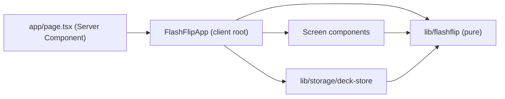
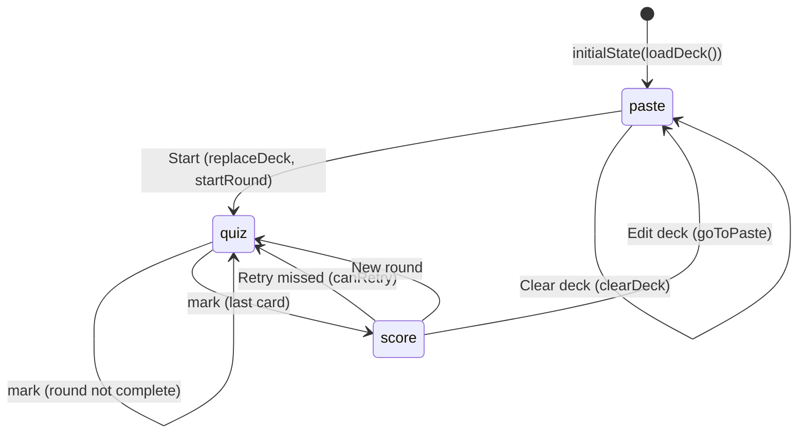
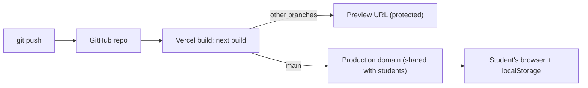

# Architecture Spine — FlashFlip MVP

## Design Paradigm

**Functional core / imperative shell.** All FlashFlip rules (parsing, shuffling, round progress, scoring, state transitions) are pure TypeScript functions. A thin React shell renders state and performs the only side effect, localStorage.

| Layer | Lives in | May import |
| --- | --- | --- |
| Core (pure domain) | `lib/flashflip/` | nothing outside `lib/flashflip/` |
| Storage adapter | `lib/storage/` | core types |
| Shell (client UI) | `components/flashflip/` | core; storage only from the root (AD-5) |
| Route | `app/` | shell |



## Invariants & Rules

### AD-1 — Pure domain core [ADOPTED]

- **Binds:** all
- **Prevents:** quiz logic spread across components, which leaves it untestable and lets it diverge
- **Rule:**
  - Parsing, shuffling, round transitions and scoring live only in `lib/flashflip/`.
  - Files there import nothing from React, Next, the DOM, or `lib/storage/`, and ESLint `no-restricted-imports` enforces this.
  - Components never re-implement these rules; they call core functions or dispatch actions.

### AD-2 — Static, client-only app [ADOPTED]

- **Binds:** `app/`, deployment
- **Prevents:** backend creep, and request-time rendering that would break the "no server" promise
- **Rule:**
  - The app has no Server Functions (`'use server'`), Route Handlers, `cookies()`/`headers()`, middleware/proxy, environment variables, or `dangerouslySetInnerHTML`.
  - `app/page.tsx` stays a Server Component and exports `ensureStatic = 'navigation'`. This needs `cacheComponents`, which is already on in `next.config.ts`; keep that and the scaffold's `partialPrefetching` as they are.
  - The page renders one `<Suspense>` boundary around the client root. Its fallback is a short "Loading your deck…" line.
  - The build must fail rather than ship a dynamic route.

### AD-3 — One storage adapter, one key, versioned shape; "no deck" is `null`

- **Binds:** deck persistence
- **Prevents:** two units writing different keys or shapes, an empty array that reads as a deck, and crashes on corrupt or unavailable storage
- **Rule:**
  - `lib/storage/deck-store.ts` is the only module that touches `localStorage`. ESLint `no-restricted-globals` enforces this for every other file.
  - It exports `loadDeck(): Card[] | null`, `saveDeck(cards: Card[]): void` and `clearDeck(): void`. The root imports it as a namespace: `import * as deckStore from '@/lib/storage/deck-store'`.
  - It uses the key `flashflip:deck:v1`, and the stored value is JSON in the shape `{ "version": 1, "cards": Card[] }`.
  - **"No deck" is `null` everywhere:** in state, from `loadDeck`, and after clearing. A deck is never `[]`.
  - `saveDeck([])` is a no-op. `clearDeck()` removes the key.
  - `loadDeck` returns `null` unless every condition below holds. It never throws, and every access is in `try/catch`.
    - `version` is `1`.
    - `cards` is a non-empty array.
    - Each card's `id`, `term` and `definition` are non-empty strings.
    - The ids are unique.
  - A failed save leaves the app usable for the current visit.

### AD-4 — Browser-only hydration via `use(browser())`

- **Binds:** client root
- **Prevents:** hydration mismatches and flicker between prerendered HTML and the saved deck
- **Rule:**
  - `FlashFlipApp` calls `use(browser('Deck is stored in localStorage.'))` from `react-dom` before reading storage.
  - It then initializes with `useReducer(flashflipReducer, null, () => initialState(deckStore.loadDeck()))`.
  - No `useEffect` reads storage, and no other component calls `browser()`.

### AD-5 — Single owner of app state; persistence from the action payload

- **Binds:** all shell components
- **Prevents:** deck or round state held in two places, and storage diverging from state
- **Rule:**
  - `components/flashflip/flashflip-app.tsx` is the only component holding domain state, and the only one that dispatches or calls `deckStore`.
  - Screens get props only (AD-11), never `dispatch` or `AppState`. They may keep ephemeral UI state: textarea text and the flipped face.
  - The root persists from the action payload it just dispatched, never from state:
    - after `replaceDeck`, it calls `deckStore.saveDeck(cards)` with the identical array;
    - after `clearDeck`, it calls `deckStore.clearDeck()`;
    - no other action causes a storage call.

### AD-6 — One parser and its inverse define the paste format

- **Binds:** paste input, deck saving, pre-fill
- **Prevents:** the preview count, the saved deck and the pre-filled text disagreeing about the format
- **Rule:** `lib/flashflip/parse.ts` exports `parseDeck(text: string): { cards: Card[]; skipped: number }` and `formatDeck(cards: Card[]): string`. They are the only implementations of the format.
  - **Lines:** `parseDeck` splits lines on `\r?\n`. Blank lines are ignored and not counted.
  - **Splitting:** each line is split at the **first** ` - ` (space, hyphen, space), and both sides are trimmed.
  - **Skipped lines:** a line is skipped and counted when it has no ` - `, or when either side is empty after trimming.
  - **Ids:** `"c"` plus the card's 0-based position among valid cards (`c0`, `c1`, …). Ids are unique within one deck and mean nothing across decks.
  - **Duplicates:** duplicate cards are kept.
  - **`formatDeck`:** joins `term + ' - ' + definition` with `'\n'`, with no trailing newline. A unit test asserts that `parseDeck(formatDeck(cards)).cards` deep-equals `cards`.

### AD-7 — Shuffle once per round, in the shell, with injectable randomness

- **Binds:** round start, retry, new round
- **Prevents:** reshuffling mid-round, different shuffle algorithms, a round built from a stale deck, and tests that can't be deterministic
- **Rule:**
  - `shuffle<T>(items: readonly T[], rng: () => number = Math.random): T[]` in `lib/flashflip/shuffle.ts` is an unbiased Fisher–Yates that returns a new array. No core function calls it with the default `rng`.
  - The root builds every round, and these are the only three ways:
    - **Start (paste screen):** dispatch `{ type: 'replaceDeck', cards }`, then `{ type: 'startRound', order: shuffle(cards.map(c => c.id)) }`. Both use the `cards` passed to `onStart`, never `state.deck`.
    - **New round:** `{ type: 'startRound', order: shuffle(state.deck.map(c => c.id)) }`
    - **Retry missed:** `{ type: 'startRound', order: shuffle(missedIds(state.round)) }`
  - A round's order never changes after creation.

### AD-8 — Round model; score is derived, results are not persisted

- **Binds:** quiz, score, retry
- **Prevents:** a stored or wrong-denominator score, a round index running past the end, and round state leaking into storage
- **Rule:**
  - `Round = { order: string[]; index: number; results: Record<string, 'knew' | 'missed'> }`
  - `lib/flashflip/round.ts` exports:
    - `scoreOf(round)`, returning `{ knew, total }` with `total = order.length`
    - `isComplete(round)`, which is true when `index === order.length`
    - `missedIds(round)`, the ids in `order` whose result is `'missed'`, in `order` order
    - `canRetry(round)`, which is true when `missedIds(round).length > 0`
  - `mark` does nothing when `round` is `null` or already complete. `index` never exceeds `order.length`, and `results` keys come only from `order`.
  - The rendered score is always `scoreOf` of the round just completed, never `deck.length`. Retry repeats until none are missed.
  - Rounds are never written to storage. A reload shows the saved deck with no round.

### AD-9 — Stored view; reducer-only transitions

- **Binds:** core reducer, client root
- **Prevents:** two owners of "which screen is showing", and a round surviving a deck change
- **Rule:**
  - `AppState = { deck: Card[] | null; round: Round | null; view: View }` with `View = 'paste' | 'quiz' | 'score'`, both exported from `lib/flashflip/types.ts`.
  - `view` is stored. Only the reducer changes it, and the shell renders the screen from `view` alone.
  - `initialState(deck)` in `reducer.ts` returns `{ deck, round: null, view: 'paste' }`.
  - Transitions:

| Action | Result |
| --- | --- |
| `replaceDeck` | `deck = cards`, `round = null`, `view = 'paste'` |
| `clearDeck` | `deck = null`, `round = null`, `view = 'paste'` |
| `startRound` | `round = { order, index: 0, results: {} }`, `view = 'quiz'`. Ignored if `deck` is `null`, `order` is empty, or any id is not in `deck` |
| `mark` | records `order[index]`, `index + 1`. Sets `view = 'score'` when the round becomes complete |
| `goToPaste` | `round = null`, `view = 'paste'` |

### AD-10 — Exact action contract

- **Binds:** core reducer, client root
- **Prevents:** reducer and dispatchers that don't type-check together, and parsing or shuffling moving into the reducer
- **Rule:**
  - `Action`, exported from `lib/flashflip/reducer.ts`, is exactly this union:
    - `{ type: 'replaceDeck'; cards: Card[] }`
    - `{ type: 'clearDeck' }`
    - `{ type: 'startRound'; order: string[] }`
    - `{ type: 'mark'; result: 'knew' | 'missed' }`
    - `{ type: 'goToPaste' }`
  - Actions are object literals; core exports no action creators.
  - Payloads carry already-parsed cards and already-shuffled ids. The reducer never parses or shuffles, and stores `replaceDeck.cards` unchanged.
  - The root dispatches `replaceDeck` only with at least one card.

### AD-11 — Screen contracts

- **Binds:** `paste-screen.tsx`, `quiz-screen.tsx`, `score-screen.tsx`, the root
- **Prevents:** screens and root disagreeing on props, stale textarea text after Clear, and the next card opening already flipped
- **Rule:** each screen exports its props type, and the root conforms to it.
  - **`PasteScreenProps = { deck: Card[] | null; onStart(cards: Card[]): void; onClear(): void }`**
    - The screen seeds its textarea once from `formatDeck(deck ?? [])`.
    - It calls `parseDeck` for both the live preview and Start, and passes exactly the previewed `cards`. Start is disabled when `cards.length === 0`.
    - The root renders it as `<PasteScreen key={deckRevision} …/>`, where `deckRevision` is a root counter incremented on every `replaceDeck` and `clearDeck`.
  - **`QuizScreenProps = { card: Card; position: number; total: number; onMark(result: 'knew' | 'missed'): void }`**
    - The root renders it with the current card's `id` as its React `key`, so every card opens on its term.
  - **`ScoreScreenProps = { knew: number; total: number; canRetry: boolean; onRetry(): void; onNewRound(): void; onEditDeck(): void }`**
    - `onEditDeck` dispatches `goToPaste`.

### AD-12 — Delivery and operations

- **Binds:** deployment, the classroom demo
- **Prevents:** a demo URL behind a Vercel login, deploys from the wrong branch, and no recovery path
- **Rule:**
  - **Source control:** the code lives in a GitHub repository, and the production branch is `main`. The local `master` branch is renamed before the first push.
  - **Vercel project:**
    - It is linked through Vercel's Git integration with the default Next.js preset.
    - Node.js is set to 24.x, matching `"engines": { "node": ">=22.12" }` in `package.json`.
  - **Deploys:**
    - Pushes to `main` deploy to production. Other branches get preview deployments, which stay behind Vercel's default deployment protection.
    - Only the production domain is shared with students.
  - **Rollback:** use Vercel's Instant Rollback to the previous production deployment.
  - **Demo fallback:** `npm run build && npm start` on the presenter's laptop.
  - **Monitoring:** none for the MVP. Vercel's build log is the only signal.

## Consistency Conventions

| Concern | Convention |
| --- | --- |
| File names | kebab-case (`deck-store.ts`, `quiz-screen.tsx`); components are PascalCase named exports, one per file |
| Core types | `Card = { id: string; term: string; definition: string }`, `Round`, `View`, `AppState`, all exported from `lib/flashflip/types.ts` |
| UI copy | The labels are exactly **Knew it** / **Missed it**. The score shows the known count and the round size separated by ` / ` (e.g. `7 / 10`). The skipped-line notice states the count |
| Styling | Tailwind utility classes only, in the existing `app/globals.css` + `@theme` setup; no CSS modules or CSS-in-JS. Phone-first: base styles target the phone and `sm:` and up enhance. Tap targets ≥ 44px |
| Accessibility | The flip control is a real `<button>`, and Enter/Space flips. Only the visible face is in the accessibility tree. Any flip animation sits inside `motion-safe:`. Both faces meet WCAG AA contrast |
| Errors | Core functions never throw on user input. Storage errors are swallowed per AD-3. There is no error UI beyond the skipped count and the disabled Start |
| Lint | `eslint.config.mjs` adds `no-restricted-imports` for `lib/flashflip/**` (no `react`, `react-dom`, `next/*`, `@/lib/storage/*`), and `no-restricted-globals` for `localStorage` everywhere except `lib/storage/deck-store.ts` |
| Tests | Vitest + jsdom with colocated `*.test.ts(x)`. `vitest.config.mts` uses `react()` and `tsconfigPaths()` so `@/` resolves. `package.json` has `"test": "vitest run"`. Every core function and every reducer transition has unit tests, and `shuffle` is tested with a seeded `rng` |
| Imports | The `@/` path alias from the scaffold's `tsconfig.json` |

## Stack

| Name | Version |
| --- | --- |
| Next.js (App Router, Turbopack) | 16.4.3 |
| React / React DOM | 19.3.0 (lockfile; patch upgrades allowed) |
| TypeScript | 5.9.3 |
| Tailwind CSS (+ `@tailwindcss/turbopack`) | 4.3.3 |
| `@types/node` | ^24 (24.19.2) |
| Vitest | 5.0.5 |
| Vite | 8.3.5 |
| `@vitejs/plugin-react` | 6.1.2 |
| `vite-tsconfig-paths` | 6.1.1 |
| jsdom | 30.1.3 |
| `@testing-library/react` / `@testing-library/dom` | 16.3.3 / 10.4.2 |
| Node.js | Vercel 24.x; local dev/test ≥ 22.12 |
| Hosting | Vercel |

## Structural Seed

```text
app/
  layout.tsx            # existing; set metadata title to FlashFlip
  page.tsx              # Server Component: ensureStatic + <Suspense> + <FlashFlipApp/>
  globals.css           # existing Tailwind v4 entry
components/flashflip/
  flashflip-app.tsx     # 'use client' root: reducer, use(browser()), deckStore calls, view switch
  paste-screen.tsx      # textarea, live parse preview, skipped count, Start / Clear deck
  quiz-screen.tsx       # one card, flip button, Knew it / Missed it, progress
  score-screen.tsx      # "7 / 10", Retry missed (if any), New round, Edit deck
lib/flashflip/
  types.ts  parse.ts  shuffle.ts  round.ts  reducer.ts   # pure core + colocated tests
lib/storage/
  deck-store.ts         # sole localStorage access
vitest.config.mts
```





## Capability → Architecture Map

| Capability / Area | Lives in | Governed by |
| --- | --- | --- |
| R1 Paste cards, skipped count | `paste-screen.tsx`, `parse.ts` | AD-1, AD-6, AD-11 |
| R2 Shuffle every round | `shuffle.ts`, `flashflip-app.tsx` | AD-7 |
| R3, R4 Flip and mark | `quiz-screen.tsx`, `reducer.ts`, `round.ts` | AD-8, AD-9, AD-11, Accessibility |
| R5 Score `7 / 10` | `score-screen.tsx`, `round.ts` | AD-8, AD-11 |
| R6 Retry missed | `round.ts`, `flashflip-app.tsx` | AD-7, AD-8 |
| R7 Deck survives reload, results don't | `deck-store.ts`, `flashflip-app.tsx` | AD-3, AD-4, AD-5, AD-8 |
| R8 Phone-first layout | all screens | Styling convention |
| R9 Start needs ≥1 card; replace; Clear | `paste-screen.tsx`, `flashflip-app.tsx` | AD-3, AD-5, AD-9, AD-11 |
| One page, no login or server; demo on production URL | `app/page.tsx`, Vercel | AD-2, AD-12 |

## Deferred

- **Visual design** (flip animation style, colours, typography, whether to keep the scaffold's dark mode): owned by `bmad-ux` if it runs, otherwise by the story 1.1 builder within the Styling and Accessibility conventions.
- **End-to-end tests:** can be added later with `bmad-qa-generate-e2e-tests`. They don't affect unit boundaries.
- **Offline/PWA, analytics, i18n, multiple decks, import/export, spaced repetition:** out of MVP scope per the initiative's Boundaries.
- **TypeScript 7:** stay on 5.x until `eslint-config-next` supports it. The lockfile pins it, so builders can't diverge.
